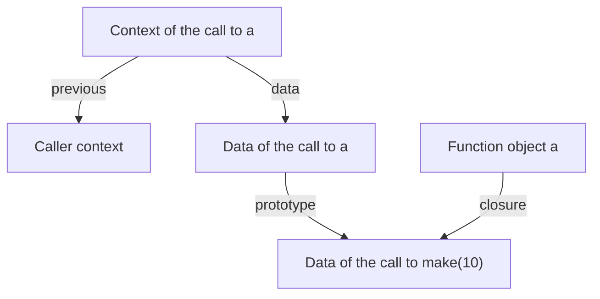

# 10. Contexts, Functions, and Closures

[Contents](index.md) · [Русский](../ru/10-contexts-and-closures.md) · [Previous chapter](09-vm-and-values.md) · [Next chapter](11-memory-management.md)

Section 10.8 is updated for receiver-bound method calls (#528), indexed access and scope-local ordinary calls. Other sections describe: [commit ae26b84, method calls and the `this` constant](https://github.com/kniazkov/g0at/tree/ae26b849471233f3329214f3c170a7a26a756118).

<a id="section-10-1"></a>

## 10.1. Scope becomes data

In chapter 7, a scope connected a name to an AST declaration. Execution needs to store concrete values instead. This is the role of `context_t` in [context.h](https://github.com/kniazkov/g0at/blob/ae26b849471233f3329214f3c170a7a26a756118/src/model/context.h): a data object, a link to the previous context, and fields controlling returns or exceptions.

`create_context` creates a new user-defined object. Its prototype is either an explicitly supplied environment or the caller context's data. Declarations create own properties on this object. A nested block can therefore see outer names, while its own declaration can shadow one of them.

There are two distinct links: `previous` leads backward through execution, while data prototypes determine name lookup. For an ordinary block they agree. For a closure call they may lead to different environments. Confusing them would silently replace lexical scope with dynamic scope, where a name depended on the call site.

<a id="section-10-2"></a>

## 10.2. What a function retains

At `FUNC`, the VM creates a dynamic function object. It stores the first body instruction's address, formal parameter names, a reference to the current context's data, and an optional descriptor of native specializations. Reference counting retains the data reference. The implementation is in [function.c](https://github.com/kniazkov/g0at/blob/ae26b849471233f3329214f3c170a7a26a756118/src/model/function.c).

A closure is a function together with its saved lexical environment. Goat retains the environment object, rather than a snapshot of individual values or a pointer to a temporary C context structure. A write to an outer variable is therefore visible to later calls of the same function. Separate calls of a factory function create separate environments.

The bytecode body can still be shared. In the example below, both counter functions execute the same instructions but read different objects holding `value`.

The diagram shows these links while calling `a` in the example below. The execution context stores the return path, while the call's data object inherits the function's environment.



<a id="section-10-3"></a>

## 10.3. How a call proceeds

`CALL` takes the function object from the stack and invokes its `call` method. For a built-in, this directly calls its C executor. For a dynamic function, a suitable native specialization may be selected first; part V examines that path. Ordinary bytecode execution performs these steps:

1. Create a call context. Its `previous` points to the caller context, while its data prototype points to the function's saved environment.
2. Mark the context `FLOW_RETURN` and save the address of the instruction after `CALL`.
3. Pop actual arguments from the stack and bind them to formal parameters in order.
4. Bind missing arguments to `null`. Extra arguments have already been evaluated, but receive no parameter names and are released.
5. Reserve a result slot on the stack, initially containing `null`, and transfer execution to the first body instruction.

Argument evaluation proceeds left to right. Binding arguments to parameters proceeds left to right as well; the stack holds the evaluated values and releases them for binding. Names in the source are not reordered.

A method call such as `obj.method(...)` differs at the call site and in the call context. Code generation for `NODE_MEMBER_ACCESS` as the callee emits `VLOAD obj`, then `DUP`, `GETPROP`, and `CALLM` instead of `CALL`: the duplicate keeps the receiver under the function on the stack. `CALLM` pops the function and then the receiver below the arguments and passes both to the function's `call` method. Section 10.8 examines what the receiver means for the call context.

<a id="section-10-4"></a>

## 10.4. Returning through nested blocks

`RET` pops the return value and writes it into the reserved slot. The VM then destroys contexts up to the current call boundary, reduces the stack to the result, and restores the continuation address and caller context. A `return` inside several blocks therefore returns from the function, rather than just leaving the nearest block.

Ordinary block completion differs: `LEAVE` retains the block's data object, destroys the context wrapper, and pushes the object. `RESTORE` only removes the context. These instructions are not interchangeable: they have different stack effects.

Destroying a context decrements its data's reference count. It need not destroy that data immediately. If a function retains the environment, the values remain available after the call that created them returns.

A `for` loop owns one context for header bindings and creates a nested body context per iteration. Retaining a closure over a body-local variable retains that iteration's object; retaining the header counter observes its later updates. A body written without braces receives the same nested scope. Return and exception handling unwind these contexts through their existing runtime paths.

<a id="section-10-5"></a>

## 10.5. Independent states and recursion

File [10-closures.goat](../examples/10-closures.goat):

```goat
const make = func(start) {
    var value = start;
    return func() { value = value + 1; return value; };
};
const a = make(10);
const b = make(20);
println(a());
println(a());
println(b());
const first = func(x) { return x; };
println(first());
println(first(7, 8));
const factorial = func(n) {
    if (n <= 1) { return 1; }
    return n * factorial(n - 1);
};
println(factorial(5));
```

Result:

```text
11
12
21
null
7
120
```

`a` and `b` retain data from different calls to `make`. Two calls to `a` modify one variable, while `b` starts from its own value. `first` demonstrates that a user function does not check for an exact argument count: a missing argument becomes `null`, and an extra one is unused.

The recursive `factorial` finds its own name through the environment. Each call creates a new context with its own `n` and return address. An environment may retain a function that retains that same environment, creating a reference cycle. Chapter 11 examines its memory consequences.

> [!CAUTION]
> Bytecode calls do not perform tail-call optimization: each such call creates another context. The current executor has no general user mechanism limiting VM recursion depth; context and stack growth are bounded by available memory. Native-path protective limits are a separate mechanism.

<a id="section-10-6"></a>

## 10.6. Processes and threads in this implementation

`process_t` owns shared runtime state and a circular list of `thread_t` records.
Each thread retains its current context, data stack, instruction index, operands,
exception and native-attempt counters. Since #217, `spawn(callable, ...arguments)`
starts an OS-backed execution in this same model; `join(id)` returns its result or
propagates its original exception. A recursive execution mutex protects shared
model operations and is released between VM instructions and around blocking waits.

All program threads are equal. Finishing the entry execution does not release
shared state or terminate other threads; ordinary cleanup waits for the last
program execution, including descendants created by surviving threads. A distinct
recursive initialization mutex serializes include/import, with dynamic spawn/join
restrictions. The directly executed entry file is excluded from those restrictions.
See [concurrency API](../../module-serialization-api.md).

A Goat `process_t` is a runtime structure, not an automatically created operating-
system process. Internal OS mutexes do not introduce user-language mutex objects.

<a id="section-10-7"></a>

## 10.7. What outlives a call

After a return, the context wrapper and temporary call values are no longer needed. However, the returned object, captured environment, and data reachable through them may live on. This is not an exceptional case; it is the basis of ordinary closure behavior.

It helps to ask two separate questions: where `RET` returns control, and who retains the data afterward. Contexts and addresses determine the first; object references determine the second. The next chapter describes that second side, including cases where reference counts cannot release an environment on their own.

<a id="section-10-8"></a>

## 10.8. Method calls: the receiver and `this`

**For `obj.method()` and `obj["method"]()`, `this` denotes `obj`, including when the function is inherited.** This intentionally replaces the earlier scope-local `this` behavior of method calls. The function still has a separate activation object for parameters and local declarations; they do not become receiver properties.

`CALLM` passes the retained receiver to the function. Bare-name lookup and assignment keep their existing rules: the activation object's own properties, the function's closure and the receiver participate in the existing lookup order. Changing the meaning of `this` does not change captures, access rights or lookup of names without `this`.

An ordinary `f()` has no receiver: its `this` remains its own call-scope object. Extracting `var f = obj.method` does not bind the function to `obj`; the eventual call syntax determines the receiver. Consequently, a method called on a different object receives that object without acquiring new private rights.

```goat
const Base = {
    var x = 1;
    const set = func(value) { this.x = value; return this; };
};
var obj = Base -> {};
println(obj.set(10) == obj); // true
println(obj.x);             // 10
println(Base.x);            // 1
obj["set"](20);
println(obj.x);             // 20

var f = obj.set;
var scope = f(30);
println(scope.x);           // 30
println(obj.x);             // 20
```

`this.x` writes an own field of the receiver, not the inherited prototype's field. This own-field rule applies to explicit dot/index writes whose target is the current scope's `this` object, including an alias such as `const self = this` used in that same scope. Other objects and bare-name writes keep their existing rules. Existing access checks and checks on own constants still apply. Bare `x` is not rewritten as `this.x`; use explicit local declarations when local storage is intended.

At the top level and in an object block, `this` continues to designate that scope's object. A nested object block has its own `this`; a nested function called as `f()` has its own call scope. Save an explicit `self` variable when an outer receiver is needed. Variables, parameters and constants cannot be named `this`; the `"this"` property remains constant.

User-defined objects expose an implicit constant `this` property without adding a dictionary entry. The method's explicit receiver binding is kept separately from activation storage and retained as a garbage-collection root until the call frame is removed. Returning or throwing restores the caller's binding; recursive calls have independent frames.

Built-in methods keep their existing receiver handling. A callable object stored in a property still receives itself, not the containing object, through its `"()"` handler. Native continuation execution uses the same VM call-frame rules; scalar specialization must not bypass receiver-dependent semantics. See the [language reference](appendix-b-language.md#section-b-index) and [callable objects](../../operator-call.md).

### Nested scopes and an explicit capture

These examples show the boundaries of `this`. An object block temporarily uses its own object; leaving it restores the method receiver. A plain nested function call creates its own call scope. A local name remains lexical.

```goat
var obj = {
    var x = 1;
    const f = func() {
        const inner = {
            this.x = 10;
            this.y = 20;
        };
        this.x = 30;
        return inner;
    };
};
var inner = obj.f();
println(obj.x);
println(inner.x);
println(inner.y);
```

Output:

```text
30
10
20
```

```goat
var obj = {
    var x = 1;
    const f = func() {
        var self = this;
        var helper = func() {
            this.x = 10;
            self.x = 20;
            return this.x;
        };
        println(helper());
        println(this.x);
    };
};
obj.f();
println(obj.x);
```

Output:

```text
10
20
20
```

```goat
var obj = {
    var x = 1;
    const f = func() {
        var x = 7;
        this.x = 9;
        println(x);
        println(this.x);
    };
};
obj.f();
```

Output:

```text
7
9
```

A returned closure can keep `self` after the method returns. Each ordinary call of that closure has a separate `this`; captured locals remain shared between its calls. The same boundaries apply to inherited methods and indexed calls. Nested object blocks do not inherit the receiver, and exception unwinding restores the enclosing frame without reverting field writes.

## 10.9. Automatic init before the derived object's block

`prototypes -> { ... }` first evaluates the prototypes and creates one target object.
It then selects and validates the entire chain of own `init` fields on real ancestors,
not lexical enclosing scopes. Bases run before derived objects; independent `[A, B]`
run as `B, A`. Diamonds and repeated prototypes visit each object once. The same
function stored on two different objects runs twice. A present non-function init,
including null or a callable object, raises `INVALID_OPERATION` before any init runs.

Each selected function receives the same target as `this` and no actual arguments.
Formal parameters are allowed and receive null; `arguments` is empty. A bare or
value-returning return exits only that init and its result is ignored. After all
initializers, the right-hand block runs and the expression yields the object.
An init declared in that block is for future descendants.

```goat
const Base = {
    const init = func() { this.x = 1; println(1); return 999; };
};
var Derived = Base -> {
    const init = func() { this.x = 2; println(2); };
};
println(0);
var obj = Derived -> {
    println(this.x);
    this.x = 3;
};
println(obj.x);
```

Output (the first 1 comes from creating Derived):

```text
1
0
1
2
2
3
```

Selection is a snapshot: replacing an ancestor's init during construction affects
later constructions only. An exception stops the chain and skips the right-hand
block, preserving its trace and previous side effects. A return in the right-hand
block still exits the surrounding function. Automatic selection accepts public,
protected and private init fields; the body retains ordinary method access rights.

Object literals and `clone()` do not run init automatically. There is no deep copy.
A manual `obj.init()` checks access, calls only the one method found by normal lookup,
and returns its ordinary result:

```goat
var obj = {
    var x = 1;
    const init = func() { this.x = 7; return 99; };
};
println(obj.x);
println(obj.init());
println(obj.x);
```

Output:

```text
1
99
7
```

## 10.10. Constructor state, snapshots and repeated inheritance

An array created by each init belongs to that object:

```goat
const Base = {
    const init = func() { this.items = [0]; };
};
var a = Base -> {};
var b = Base -> {};
a.items[0] = 7;
println(a.items[0]);
println(b.items[0]);
```

Output:

```text
7
0
```

Assigning an existing array deliberately shares it. No automatic copying occurs:

```goat
const shared = [0];
const Base = { const init = func() { this.items = shared; }; };
var a = Base -> {};
var b = Base -> {};
a.items[0] = 7;
println(a.items[0]); println(b.items[0]); println(shared[0]);
println(a.items == b.items);
```

Output:

```text
7
7
7
true
```

The current chain keeps the selected function objects. Only the next construction sees replacements:

```goat
const A = {
    var init = func() { println(1); };
};
const B = {
    const init = func() {
        A.init = func() { println(9); };
        println(2);
    };
};
var first = [A, B] -> {};
var second = [A, B] -> {};
```

Output:

```text
2
1
2
9
```

Deduplication is by ancestor object, not function identity:

```goat
const f = func() { println(7); };
const A = { const init = f; };
const B = { const init = f; };
var obj = [A, B] -> {};
```

Output:

```text
7
7
```

Cloning preserves ordinary clone behavior and does not rerun initialization:

```goat
const Base = {
    const init = func() { this.x = 1; println(8); };
};
var a = Base -> {};
a.x = 5;
var b = a.clone();
println(b.x);
```

Output:

```text
8
5
```

A diamond runs the common ancestor once. Repeated direct prototypes also run
once per object. Base init precedes derived init even when both appear in either
order in the prototype list. Missing own init does not stop traversal.

A base init calling `this.prepare()` uses ordinary lookup on the final receiver:
a derived override can run before the derived init. Assignments to `this` create or
update receiver fields without modifying ancestors; own constants and access checks
still apply. An object block inside init has its own `this`, and leaving it restores
the constructor receiver.

Recursive construction, including constructing the same prototype from its init,
uses separate snapshots and receivers. If an init saves `this` externally and then
throws, that partial object remains usable with earlier writes intact; later init
and the right-hand block are skipped. The runtime retains the receiver, pending
functions and captured values across GC and releases the snapshot on success or
exception. These lifetime guarantees do not imply rollback or deep copying.
