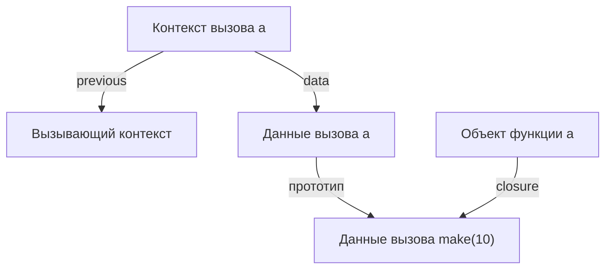

# 10. Контексты, функции и замыкания

[Оглавление](index.md) · [English](../en/10-contexts-and-closures.md) · [Предыдущая глава](09-vm-and-values.md) · [Следующая глава](11-memory-management.md)

Раздел 10.8 обновлён для индексного доступа и `this` в каждой области. Остальные разделы описывают: [commit ae26b84, вызовы методов и константа `this`](https://github.com/kniazkov/g0at/tree/ae26b849471233f3329214f3c170a7a26a756118).

<a id="section-10-1"></a>

## 10.1. Область видимости становится данными

В главе 7 область видимости связывала имя с объявлением в AST. Во время исполнения требуется хранить уже конкретные значения. Для этого используется `context_t` из [context.h](https://github.com/kniazkov/g0at/blob/ae26b849471233f3329214f3c170a7a26a756118/src/model/context.h): объект данных, ссылка на предыдущий контекст и поля управления возвратом или исключением.

`create_context` создаёт новый пользовательский объект. Его прототипом становится явно переданное окружение либо данные вызывающего контекста. Объявления создают собственные свойства этого объекта. Вложенный блок таким образом видит внешние имена, а собственное объявление может затенить одно из них.

Есть две разные связи: `previous` ведёт назад по ходу исполнения, а прототипы данных определяют поиск имён. Для обычного блока они согласованы. Для вызова замыкания они могут вести к разным окружениям. Смешать их — значит незаметно заменить лексическую область видимости динамической, где имя зависело бы от места вызова.

<a id="section-10-2"></a>

## 10.2. Что сохраняет функция

При `FUNC` VM создаёт динамический объект функции. Он хранит адрес первой инструкции тела, имена формальных параметров, ссылку на данные текущего контекста и необязательный дескриптор нативных специализаций. Ссылка на данные удерживается счётчиком ссылок. Реализация находится в [function.c](https://github.com/kniazkov/g0at/blob/ae26b849471233f3329214f3c170a7a26a756118/src/model/function.c).

Замыкание — функция вместе с сохранённым лексическим окружением. Goat удерживает объект окружения, а не снимок отдельных значений и не указатель на временную C-структуру контекста. Поэтому запись во внешнюю переменную видна последующим вызовам этой же функции. Отдельные вызовы функции-фабрики создают отдельные окружения.

Тело байткода при этом может быть общим. В примере ниже обе функции-счётчика исполняют одни инструкции, но читают разные объекты с переменной `value`.

На схеме показаны эти связи во время вызова `a` из примера ниже. Контекст выполнения хранит путь возврата, а объект данных вызова наследует окружение функции.



<a id="section-10-3"></a>

## 10.3. Как проходит вызов

`CALL` получает со стека объект функции и вызывает его метод `call`. Для встроенной функции это непосредственный вызов C-исполнителя. Для динамической функции сначала возможен выбор подходящей нативной специализации; этот путь подробно рассматривается в части V. При обычном исполнении байткода выполняются следующие действия:

1. Создаётся контекст вызова. Его `previous` указывает на вызывающий контекст, а прототип данных — на сохранённое окружение функции.
2. Контекст помечается `FLOW_RETURN`; сохраняется адрес следующей после `CALL` инструкции.
3. Фактические аргументы снимаются со стека и связываются с формальными параметрами по порядку.
4. Для отсутствующих аргументов записывается `null`. Лишние уже вычислены, но не получают имён параметров и освобождаются.
5. На стеке резервируется ячейка результата, первоначально содержащая `null`. Исполнение переходит к первой инструкции тела.

Аргументы вычисляются слева направо; их привязка к параметрам также идёт слева направо. Стек хранит вычисленные значения и отдаёт их для привязки; имена в исходнике не переставляются.

Вызов метода `obj.method(...)` отличается и в месте вызова, и в контексте вызова. При генерации кода для `NODE_MEMBER_ACCESS` в роли вызываемого выражения выводятся `VLOAD obj`, затем `DUP`, `GETPROP` и `CALLM` вместо `CALL`: дубликат оставляет получатель на стеке под функцией. `CALLM` снимает функцию, а затем получатель под аргументами, и передаёт их обоих методу `call` функции. Что получатель означает для контекста вызова, рассматривается в разделе 10.8.

<a id="section-10-4"></a>

## 10.4. Возврат через вложенные блоки

`RET` снимает возвращаемое значение и записывает его в зарезервированную ячейку. Затем VM уничтожает контексты до границы текущего вызова, сокращает стек до результата, восстанавливает адрес продолжения и вызывающий контекст. `return` внутри нескольких блоков поэтому возвращает из функции, а не только из ближайшего блока.

Обычное завершение блока устроено иначе: `LEAVE` сохраняет его объект данных, уничтожает оболочку контекста и кладёт объект на стек. `RESTORE` только удаляет контекст. Эти инструкции нельзя взаимозаменять: у них разный результат для стека.

Уничтожение контекста уменьшает счётчик ссылок его данных. Оно не обязано уничтожать данные немедленно. Если функция удерживает окружение, значения остаются доступны после возврата создавшего их вызова.

Цикл `for` владеет одним контекстом для привязок заголовка и создаёт вложенный контекст тела на каждой итерации. Замыкание над локальной переменной тела удерживает объект конкретной итерации; захват счётчика заголовка наблюдает его последующие изменения. Тело без фигурных скобок получает такую же вложенную область. Возврат и обработка исключения раскручивают эти контексты существующими путями исполнительной среды.

<a id="section-10-5"></a>

## 10.5. Независимые состояния и рекурсия

Файл [10-closures.goat](../examples/10-closures.goat):

```goat
const make = func(start) {
    var value = start;
    return func() { value = value + 1; return value; };
};
const a = make(10);
const b = make(20);
println(a());
println(a());
println(b());
const first = func(x) { return x; };
println(first());
println(first(7, 8));
const factorial = func(n) {
    if (n <= 1) { return 1; }
    return n * factorial(n - 1);
};
println(factorial(5));
```

Результат:

```text
11
12
21
null
7
120
```

`a` и `b` удерживают разные данные вызовов `make`. Два обращения к `a` изменяют одну переменную, а `b` начинает со своего значения. `first` показывает отсутствие проверки точного количества аргументов у пользовательской функции: недостающий становится `null`, лишний не используется.

Рекурсивная `factorial` находит собственное имя через окружение. Каждый вызов создаёт новый контекст с собственным `n` и адресом возврата. Окружение может удерживать функцию, которая удерживает это же окружение: возникает цикл ссылок. Его последствия для памяти рассматриваются в главе 11.

> [!CAUTION]
> Байткодный вызов не выполняет оптимизацию хвостовой рекурсии: каждый такой вызов создаёт очередной контекст. В текущем исполнителе нет общего пользовательского механизма ограничения глубины VM-рекурсии; рост контекстов и стека ограничен доступной памятью. Защитные лимиты нативного пути — отдельный механизм.

<a id="section-10-6"></a>

## 10.6. Процесс и поток в этой реализации

`process_t` владеет общим состоянием и кольцевым списком записей `thread_t`.
Поток хранит текущий контекст, стек данных, индекс инструкции, операнды,
исключение и счётчики нативных попыток. Начиная с #217,
`spawn(callable, ...arguments)` запускает исполнение в потоке ОС на основе этой же
модели; `join(id)` возвращает результат либо распространяет исходное исключение.
Рекурсивный мьютекс исполнения защищает общую модель и освобождается между
инструкциями VM и при блокирующих ожиданиях.

Все потоки программы равноправны. Завершение входного исполнения не освобождает
общее состояние и не останавливает остальные потоки; обычная очистка начинается
после последнего исполнения, включая потомков, созданных оставшимися потоками.
Отдельный рекурсивный мьютекс инициализации сериализует include/import, а
динамический контекст запрещает spawn/join. Прямое исполнение входного файла
исключено из этих ограничений. См. [API конкурентности](../../module-serialization-api.md).

`process_t` — структура исполнительной среды Goat, а не автоматически созданный
процесс ОС. Внутренние мьютексы ОС не вводят пользовательских объектов мьютекса.

<a id="section-10-7"></a>

## 10.7. Что переживает вызов

После возврата больше не нужны оболочка контекста и временные значения вызова. Однако возвращённый объект, захваченное окружение и данные, достижимые через них, могут жить дальше. Это не исключительный случай, а основа обычной работы замыканий.

Полезно проверить две вещи отдельно: куда `RET` возвращает управление и кто удерживает данные после этого. Первое определяется контекстами и адресами; второе — объектными ссылками. Следующая глава описывает именно вторую сторону, включая случаи, когда счётчики ссылок не могут освободить окружение сами.

<a id="section-10-8"></a>

## 10.8. Вызовы методов: получатель и `this`

Вызов метода передаёт в вызов получатель — объект, для которого метод вызывается. `CALLM` отдаёт его функции `dynamic_call`, которая строит объект данных вызова из списка прототипов: для вызова метода в список входят замыкание функции и затем получатель; обычный вызов сохраняет только замыкание. Поиск имени через `VLOAD` поэтому проверяет собственные свойства, затем окружение замыкания, затем свойства получателя. Обновление необъявленного имени в теле метода (раздел 7.6) разрешается тем же обходом: `STORE` находит существующее свойство по цепочке или создаёт его в собственных данных вызова.

**В Goat `this` — объект текущей области видимости. Это принципиально отличается от привычной семантики Java и JavaScript.** В Java `this` в экземплярном методе обозначает текущий экземпляр класса. В JavaScript при обычном вызове `obj.method()` через свойство `this` у несвязанной обычной функции обозначает `obj`; у стрелочных функций он лексический. В Goat даже внутри `obj.method()` `this` обозначает отдельный объект контекста вызова, **не `obj`**. Получатель доступен через прототипы контекста, поэтому `this.x` может найти его свойство, но равенство `this == obj` будет ложным.

`this` доступен и без вызова функции: на верхнем уровне, при выполнении объектного блока `{ ... }`, во вложенном блоке и в обычной функции. Каждый новый контекст имеет собственный `this`. После выхода из блока прежний контекст снова становится текущим. Именовать переменную, параметр или константу `this` запрещено; запись в свойство `"this"` вызывает `PROPERTY_IS_CONSTANT`.

```goat
var obj = {
    this["x"] = 1;
    this[true] = 2;
    var inner = {
        var x = 3;
        this[false] = 4;
    };
};
println(obj.x);             // 1
println(obj[true]);         // 2
println(obj.inner[false]);  // 4
println(obj.inner.this == obj.inner); // true

obj.inspect = func() {
    println(this == obj);   // false: отдельный контекст вызова
    println(this.x);        // 1: найдено через прототип
    this["local"] = 9;      // новое свойство контекста вызова
    return this;
};
var context = obj.inspect();
println(context.local);     // 9
println(obj.local);         // null
```

**Важно:** запись через `this` сохраняет обычные правила свойств Goat. Существующее свойство может обновляться в прототипе; новое создаётся в текущем объекте. Если вложенному блоку нужно собственное `x`, затеняющее внешнее, объяви `var x` или `const x`. Неявное объявление `x = 1` создаёт константу; `this["x"] = 1` создаёт обычное изменяемое свойство, если его ещё нет.

У пользовательского объекта `this` доступен как неявное константное свойство, не добавляющее запись в словарь: пустой объект остаётся пустым и ложным. Для совместимости контексты вызовов сохраняют прежнее явно записанное свойство `this`. В обоих случаях ссылка указывает на сам объект и не требует сильной циклической ссылки. Индексный доступ подробно описан в [справочнике языка](appendix-b-language.md#section-b-index).

```goat
const obj = {};
obj.x = 0;
obj.getX = func() { return ++x; };
println(obj.getX());
println(obj.getX());
```

Тело метода ни разу не называет `obj`. Оба вызова всё равно находят `x` через прототип получателя и печатают `1`, затем `2`. Функция, полученная из фабрики и установленная на объект, ведёт себя так же: получатель определяется объектом, на котором вызывается метод, а не местом создания функции.
