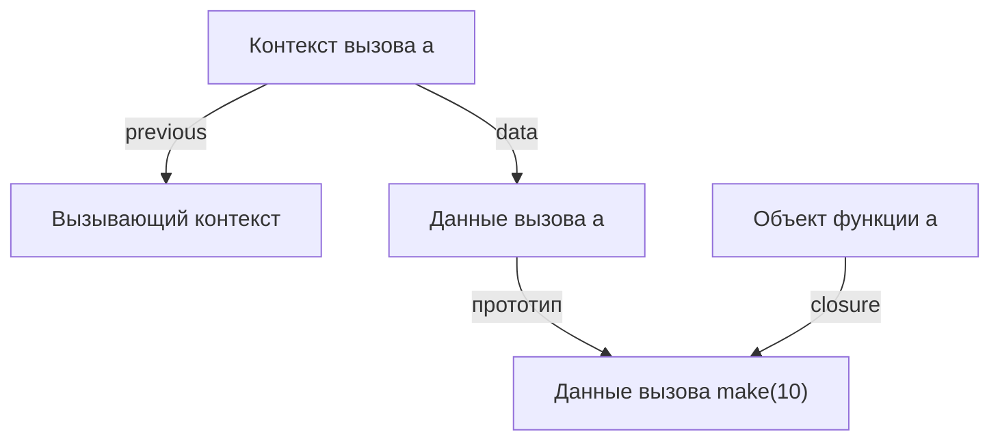

# 10. Контексты, функции и замыкания

[Оглавление](index.md) · [English](../en/10-contexts-and-closures.md) · [Предыдущая глава](09-vm-and-values.md) · [Следующая глава](11-memory-management.md)

Раздел 10.8 обновлён для получателя метода (#528), индексного доступа и обычных вызовов с `this` области. Остальные разделы описывают: [commit ae26b84, вызовы методов и константа `this`](https://github.com/kniazkov/g0at/tree/ae26b849471233f3329214f3c170a7a26a756118).

<a id="section-10-1"></a>

## 10.1. Область видимости становится данными

В главе 7 область видимости связывала имя с объявлением в AST. Во время исполнения требуется хранить уже конкретные значения. Для этого используется `context_t` из [context.h](https://github.com/kniazkov/g0at/blob/ae26b849471233f3329214f3c170a7a26a756118/src/model/context.h): объект данных, ссылка на предыдущий контекст и поля управления возвратом или исключением.

`create_context` создаёт новый пользовательский объект. Его прототипом становится явно переданное окружение либо данные вызывающего контекста. Объявления создают собственные свойства этого объекта. Вложенный блок таким образом видит внешние имена, а собственное объявление может затенить одно из них.

Есть две разные связи: `previous` ведёт назад по ходу исполнения, а прототипы данных определяют поиск имён. Для обычного блока они согласованы. Для вызова замыкания они могут вести к разным окружениям. Смешать их — значит незаметно заменить лексическую область видимости динамической, где имя зависело бы от места вызова.

<a id="section-10-2"></a>

## 10.2. Что сохраняет функция

При `FUNC` VM создаёт динамический объект функции. Он хранит адрес первой инструкции тела, имена формальных параметров, ссылку на данные текущего контекста и необязательный дескриптор нативных специализаций. Ссылка на данные удерживается счётчиком ссылок. Реализация находится в [function.c](https://github.com/kniazkov/g0at/blob/ae26b849471233f3329214f3c170a7a26a756118/src/model/function.c).

Замыкание — функция вместе с сохранённым лексическим окружением. Goat удерживает объект окружения, а не снимок отдельных значений и не указатель на временную C-структуру контекста. Поэтому запись во внешнюю переменную видна последующим вызовам этой же функции. Отдельные вызовы функции-фабрики создают отдельные окружения.

Тело байткода при этом может быть общим. В примере ниже обе функции-счётчика исполняют одни инструкции, но читают разные объекты с переменной `value`.

На схеме показаны эти связи во время вызова `a` из примера ниже. Контекст выполнения хранит путь возврата, а объект данных вызова наследует окружение функции.



<a id="section-10-3"></a>

## 10.3. Как проходит вызов

`CALL` получает со стека объект функции и вызывает его метод `call`. Для встроенной функции это непосредственный вызов C-исполнителя. Для динамической функции сначала возможен выбор подходящей нативной специализации; этот путь подробно рассматривается в части V. При обычном исполнении байткода выполняются следующие действия:

1. Создаётся контекст вызова. Его `previous` указывает на вызывающий контекст, а прототип данных — на сохранённое окружение функции.
2. Контекст помечается `FLOW_RETURN`; сохраняется адрес следующей после `CALL` инструкции.
3. Фактические аргументы снимаются со стека и связываются с формальными параметрами по порядку.
4. Для отсутствующих аргументов записывается `null`. Лишние уже вычислены, но не получают имён параметров и освобождаются.
5. На стеке резервируется ячейка результата, первоначально содержащая `null`. Исполнение переходит к первой инструкции тела.

Аргументы вычисляются слева направо; их привязка к параметрам также идёт слева направо. Стек хранит вычисленные значения и отдаёт их для привязки; имена в исходнике не переставляются.

Вызов метода `obj.method(...)` отличается и в месте вызова, и в контексте вызова. При генерации кода для `NODE_MEMBER_ACCESS` в роли вызываемого выражения выводятся `VLOAD obj`, затем `DUP`, `GETPROP` и `CALLM` вместо `CALL`: дубликат оставляет получатель на стеке под функцией. `CALLM` снимает функцию, а затем получатель под аргументами, и передаёт их обоих методу `call` функции. Что получатель означает для контекста вызова, рассматривается в разделе 10.8.

<a id="section-10-4"></a>

## 10.4. Возврат через вложенные блоки

`RET` снимает возвращаемое значение и записывает его в зарезервированную ячейку. Затем VM уничтожает контексты до границы текущего вызова, сокращает стек до результата, восстанавливает адрес продолжения и вызывающий контекст. `return` внутри нескольких блоков поэтому возвращает из функции, а не только из ближайшего блока.

Обычное завершение блока устроено иначе: `LEAVE` сохраняет его объект данных, уничтожает оболочку контекста и кладёт объект на стек. `RESTORE` только удаляет контекст. Эти инструкции нельзя взаимозаменять: у них разный результат для стека.

Уничтожение контекста уменьшает счётчик ссылок его данных. Оно не обязано уничтожать данные немедленно. Если функция удерживает окружение, значения остаются доступны после возврата создавшего их вызова.

Цикл `for` владеет одним контекстом для привязок заголовка и создаёт вложенный контекст тела на каждой итерации. Замыкание над локальной переменной тела удерживает объект конкретной итерации; захват счётчика заголовка наблюдает его последующие изменения. Тело без фигурных скобок получает такую же вложенную область. Возврат и обработка исключения раскручивают эти контексты существующими путями исполнительной среды.

<a id="section-10-5"></a>

## 10.5. Независимые состояния и рекурсия

Файл [10-closures.goat](../examples/10-closures.goat):

```goat
const make = func(start) {
    var value = start;
    return func() { value = value + 1; return value; };
};
const a = make(10);
const b = make(20);
println(a());
println(a());
println(b());
const first = func(x) { return x; };
println(first());
println(first(7, 8));
const factorial = func(n) {
    if (n <= 1) { return 1; }
    return n * factorial(n - 1);
};
println(factorial(5));
```

Результат:

```text
11
12
21
null
7
120
```

`a` и `b` удерживают разные данные вызовов `make`. Два обращения к `a` изменяют одну переменную, а `b` начинает со своего значения. `first` показывает отсутствие проверки точного количества аргументов у пользовательской функции: недостающий становится `null`, лишний не используется.

Рекурсивная `factorial` находит собственное имя через окружение. Каждый вызов создаёт новый контекст с собственным `n` и адресом возврата. Окружение может удерживать функцию, которая удерживает это же окружение: возникает цикл ссылок. Его последствия для памяти рассматриваются в главе 11.

> [!CAUTION]
> Байткодный вызов не выполняет оптимизацию хвостовой рекурсии: каждый такой вызов создаёт очередной контекст. В текущем исполнителе нет общего пользовательского механизма ограничения глубины VM-рекурсии; рост контекстов и стека ограничен доступной памятью. Защитные лимиты нативного пути — отдельный механизм.

<a id="section-10-6"></a>

## 10.6. Процесс и поток в этой реализации

`process_t` владеет общим состоянием и кольцевым списком записей `thread_t`.
Поток хранит текущий контекст, стек данных, индекс инструкции, операнды,
исключение и счётчики нативных попыток. Начиная с #217,
`spawn(callable, ...arguments)` запускает исполнение в потоке ОС на основе этой же
модели; `join(id)` возвращает результат либо распространяет исходное исключение.
Рекурсивный мьютекс исполнения защищает общую модель и освобождается между
инструкциями VM и при блокирующих ожиданиях.

Все потоки программы равноправны. Завершение входного исполнения не освобождает
общее состояние и не останавливает остальные потоки; обычная очистка начинается
после последнего исполнения, включая потомков, созданных оставшимися потоками.
Отдельный рекурсивный мьютекс инициализации сериализует include/import, а
динамический контекст запрещает spawn/join. Прямое исполнение входного файла
исключено из этих ограничений. См. [API конкурентности](../../module-serialization-api.md).

`process_t` — структура исполнительной среды Goat, а не автоматически созданный
процесс ОС. Внутренние мьютексы ОС не вводят пользовательских объектов мьютекса.

<a id="section-10-7"></a>

## 10.7. Что переживает вызов

После возврата больше не нужны оболочка контекста и временные значения вызова. Однако возвращённый объект, захваченное окружение и данные, достижимые через них, могут жить дальше. Это не исключительный случай, а основа обычной работы замыканий.

Полезно проверить две вещи отдельно: куда `RET` возвращает управление и кто удерживает данные после этого. Первое определяется контекстами и адресами; второе — объектными ссылками. Следующая глава описывает именно вторую сторону, включая случаи, когда счётчики ссылок не могут освободить окружение сами.

<a id="section-10-8"></a>

## 10.8. Вызовы методов: получатель и `this`

**При `obj.method()` и `obj["method"]()` значение `this` обозначает `obj`, в том числе если функция унаследована.** Это намеренное изменение прежней семантики методов, где `this` обозначал область вызова. Для параметров и локальных объявлений по-прежнему создаётся отдельный объект активации; они не становятся полями получателя.

`CALLM` передаёт функции удерживаемого получателя. Поиск и запись имён без `this` сохраняют прежние правила: собственные свойства области вызова, замыкание функции и получатель участвуют в существующем порядке поиска. Изменение значения `this` не меняет захваты, права доступа или разрешение имён без `this`.

У обычного `f()` нет получателя: его `this` остаётся собственной областью вызова. Извлечение `var f = obj.method` не связывает функцию с `obj`; получатель определяется способом последующего вызова. Поэтому при вызове метода на другом объекте функция получает этот объект, но не приобретает новые приватные права.

```goat
const Base = {
    var x = 1;
    const set = func(value) { this.x = value; return this; };
};
var obj = Base -> {};
println(obj.set(10) == obj); // true
println(obj.x);             // 10
println(Base.x);            // 1
obj["set"](20);
println(obj.x);             // 20

var f = obj.set;
var scope = f(30);
println(scope.x);           // 30
println(obj.x);             // 20
```

`this.x` записывает собственное поле получателя, а не поле унаследованного прототипа. Это правило применяется к явной записи через точку или индекс, если её цель совпадает с объектом `this` текущей области, включая псевдоним вроде `const self = this` в той же области. Запись в другие объекты и по именам без `this` сохраняет прежние правила. Прежние проверки доступа и собственных констант сохраняются. Имя `x` без `this` не переписывается в `this.x`; для локального хранилища используйте явные локальные объявления.

На верхнем уровне и в объектном блоке `this` по-прежнему обозначает объект соответствующей области. Вложенный объектный блок имеет собственный `this`; вложенная функция при вызове `f()` имеет собственную область вызова. Если нужен внешний получатель, сохраните его в явной переменной `self`. Именовать переменную, параметр или константу `this` нельзя; свойство `"this"` остаётся константным.

Пользовательский объект предоставляет неявное константное свойство `this` без добавления записи в словарь. Явная привязка получателя метода хранится отдельно от данных активации и удерживается как корень сборки мусора до удаления кадра вызова. Возврат или исключение восстанавливает привязку вызывающего кода; рекурсивные вызовы имеют независимые кадры.

Встроенные методы сохраняют прежнюю обработку получателя. Вызываемый объект в свойстве получает через обработчик `"()"` себя, а не содержащий его объект. Нативные продолжения используют те же правила кадров VM; скалярная специализация не должна обходить семантику, зависящую от получателя. См. [справочник языка](appendix-b-language.md#section-b-index) и [вызываемые объекты](../../operator-call.ru.md).

### Вложенные области и явный захват

Эти примеры показывают границы `this`. Объектный блок временно использует собственный объект; после выхода снова доступен получатель метода. Обычный вызов вложенной функции создаёт собственную область вызова. Локальное имя сохраняет лексическую семантику.

```goat
var obj = {
    var x = 1;
    const f = func() {
        const inner = {
            this.x = 10;
            this.y = 20;
        };
        this.x = 30;
        return inner;
    };
};
var inner = obj.f();
println(obj.x);
println(inner.x);
println(inner.y);
```

Вывод:

```text
30
10
20
```

```goat
var obj = {
    var x = 1;
    const f = func() {
        var self = this;
        var helper = func() {
            this.x = 10;
            self.x = 20;
            return this.x;
        };
        println(helper());
        println(this.x);
    };
};
obj.f();
println(obj.x);
```

Вывод:

```text
10
20
20
```

```goat
var obj = {
    var x = 1;
    const f = func() {
        var x = 7;
        this.x = 9;
        println(x);
        println(this.x);
    };
};
obj.f();
```

Вывод:

```text
7
9
```

Возвращённое замыкание может хранить `self` после возврата из метода. Каждый обычный вызов замыкания имеет отдельный `this`; захваченные локальные переменные остаются общими между его вызовами. Эти же границы действуют для унаследованных методов и вызовов через индекс. Вложенные объектные блоки не наследуют получателя, а раскрутка стека при исключении восстанавливает внешний кадр без отмены записей в поля.

## 10.9. Автоматический init перед блоком производного объекта

`prototypes -> { ... }` сначала вычисляет прототипы и создаёт один целевой объект.
Затем выбирает и проверяет всю цепочку собственных полей `init` реальных предков,
не лексических внешних областей. Базовые объекты идут перед производными;
независимые `[A, B]` — в порядке `B, A`. Ромбы и повторы прототипов посещают каждый
объект один раз. Одна функция у двух разных объектов вызывается дважды.
Присутствующий init, не являющийся функцией, включая null и вызываемый объект,
вызывает `INVALID_OPERATION` до любого init.

Каждая выбранная функция получает один целевой `this` и ноль фактических аргументов.
Формальные параметры разрешены и получают null; `arguments` пуст. return без значения
или со значением завершает только этот init, его результат игнорируется. После всех
инициализаторов выполняется правый блок, а выражение возвращает объект.
Объявленный в этом блоке init предназначен для будущих потомков.

```goat
const Base = {
    const init = func() { this.x = 1; println(1); return 999; };
};
var Derived = Base -> {
    const init = func() { this.x = 2; println(2); };
};
println(0);
var obj = Derived -> {
    println(this.x);
    this.x = 3;
};
println(obj.x);
```

Вывод (первая 1 относится к созданию Derived):

```text
1
0
1
2
2
3
```

Выбор является снимком: замена init предка во время создания влияет только на
последующие создания. Исключение останавливает цепочку и пропускает правый блок,
сохраняя трассировку и предыдущие побочные эффекты. return в правом блоке
по-прежнему выходит из окружающей функции. Автоматический выбор принимает public,
protected и private init; тело сохраняет обычные права доступа метода.

Объектные литералы и `clone()` не вызывают init автоматически. Глубокого копирования
нет. Ручной `obj.init()` проверяет доступ, вызывает только один метод, найденный
обычным поиском, и возвращает его обычный результат:

```goat
var obj = {
    var x = 1;
    const init = func() { this.x = 7; return 99; };
};
println(obj.x);
println(obj.init());
println(obj.x);
```

Вывод:

```text
1
99
7
```
