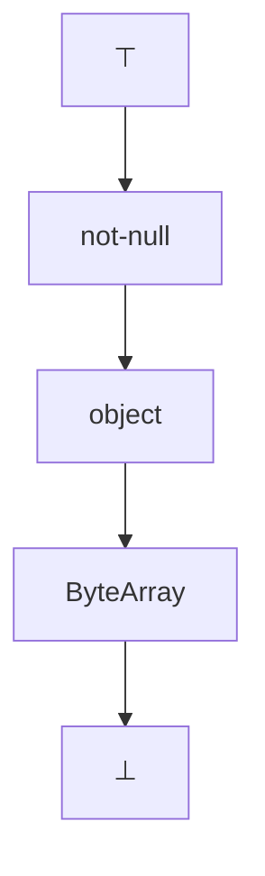

# ByteArray lattice — first half of BA-10

Edges show containment, with the broader domain above. ByteArray denotes any user-defined object with its own byte payload, including descendants and overridden methods/operators. It is disjoint from Array and scalar domains. It is not an immutable constant or an allocation identity.

| Other domain | join with ByteArray | meet with ByteArray |
|---|---|---|
| bottom | ByteArray | bottom |
| ByteArray | ByteArray | ByteArray |
| object | object | ByteArray |
| not-null | not-null | ByteArray |
| top | top | ByteArray |
| null | top | bottom |
| Array/scalars/functions | not-null | bottom |

Truthiness is EITHER, even for literals: a later alias can clear or fill the buffer. The domain carries no length, bytes, identity, freshness or method guarantees. Operator dispatch remains possible; pure C specialization is not added. Typed array diagnostics may display array<ByteArray>.

This review checkpoint adds the domain and algebra only. Literal and builtin producers still use the existing conservative object/TOP results. Function specialization summaries widen to object; serialized metadata also exports object. Existing enum numbers remain unchanged. Module-scope values retain their distinct internal representation and are not ByteArray values.

The second half must connect producers, model allocation/return identity and mutation/alias invalidation, test unknown calls and inherited overrides, and coordinate richer export/import contracts with BA-11. No length/content refinement is authorized by this PR.

core.byte_lattice checks the subtype, display, dispatch/truthiness, typed arrays and lattice laws over representative broad domains.
