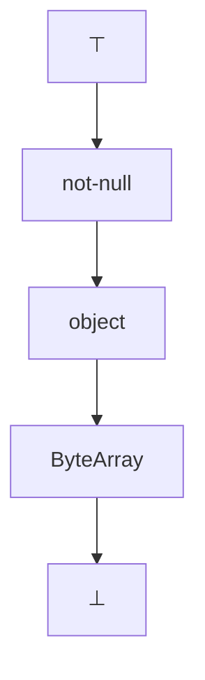

# Решётка ByteArray — первая половина BA-10

Рёбра показывают включение: сверху более широкий домен. ByteArray означает пользовательский объект с собственным байтовым payload, включая потомков и переопределённые операторы/методы. Он не пересекается с Array и скалярными доменами. Это не неизменяемая константа и не идентификатор аллокации.

| Другой домен | join с ByteArray | meet с ByteArray |
|---|---|---|
| bottom | ByteArray | bottom |
| ByteArray | ByteArray | ByteArray |
| object | object | ByteArray |
| not-null | not-null | ByteArray |
| top | top | ByteArray |
| null | top | bottom |
| Array/скаляры/функции | not-null | bottom |

Truthiness — EITHER, даже для литерала: alias позже может очистить или заполнить буфер. Домен не содержит длину, байты, идентичность, freshness или гарантии методов. Возможность пользовательской диспетчеризации сохранена, специализации чистого C не добавляются. Типизированный массив отображается как array<ByteArray>.

Это точка просмотра модели: добавлены домен и его алгебра. Литералы и builtin producers пока возвращают прежние консервативные object/TOP. В summaries специализаций и экспортных метаданных домен расширяется до object. Прежние номера enum сохранены. Значения module scope имеют отдельное внутреннее представление и не считаются ByteArray.

Во второй половине предстоит подключить producers, описать allocation/return identity и mutation/alias invalidation, проверить неизвестные вызовы и наследуемые переопределения, согласовать более точные export/import summaries с BA-11. Этот PR не вводит уточнений длины/содержимого.

core.byte_lattice проверяет подтип, отображение, dispatch/truthiness, типизированные массивы и законы решётки на представительных широких доменах.
